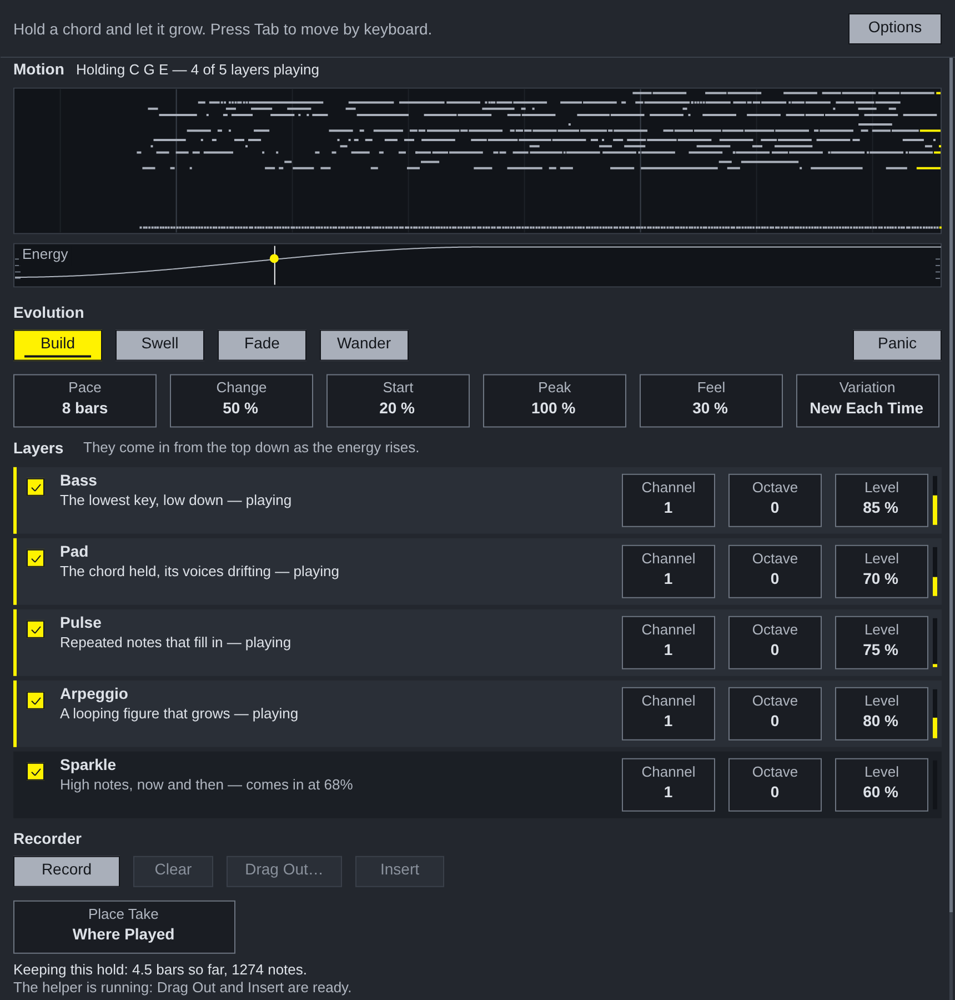

# Midi Evolver for Ableton Live

A Max for Live MIDI effect. It is `Midi Evolver.jsfx` itself, unchanged, running on Middaw's EEL2 runtime, with its own window: hold a chord and it grows.

## Installing

Needs **Live 12.1 or later with Max for Live** (Live Suite, or Standard with
the add-on): the device runs on Max 9's JavaScript engine (`[v8ui]`).

1. Copy `Midi Evolver.amxd`, `MidiEvolver.js` and `MidiEvolver.maxpat` into one folder, for
   example `Music/Ableton/User Library/Presets/MIDI Effects/Max MIDI Effect/`. The `.amxd` finds
   `MidiEvolver.js` beside it.
2. Drag `Midi Evolver.amxd` onto a MIDI track, in front of an instrument.
3. Optional: open it in the Max editor and click **Freeze Device**, then save.
   The device then carries the script inside it and can be moved on its own.

## Using it

| | |
| --- | --- |
| **Show Window** | Opens Midi Evolver's own window, the one REAPER shows. Click, drag and Tab work as they do there. |
| **Insert, Drag Out** | The window's own buttons work: the device answers them the way `Midi Evolver Helper.lua` does in REAPER, so there is no helper to run. The take goes on a new MIDI track beside this one, so it is heard as played rather than evolved again. Live cannot start a drag from a device, so Drag Out does the same and says so. |
| **Insert the Take** | The same from the device strip, without opening the window. |

Everything Midi Evolver saves in REAPER (its @serialize) is saved with the Live set.

## How it is built

`ableton/device.json` describes the device; `python3 ableton/kit/build.py
ableton/device.json` writes the `.amxd`, the `.maxpat` and the script bundle
`MidiEvolver.js`. The bundle is Middaw's EEL2 runtime, `Midi Evolver.jsfx` from the repository root, the shared window (`ableton/kit/jsfx_device.js`, `gfx.js`) and `ableton/actions.js`, the helper's part. See `ableton/kit/VENDORED.md`.

`node --test ableton/tests/test_device.js` runs the device on a pretend Max and Live: the window draws and answers clicks all over it, notes go through and end, a held chord grows, the take goes on a new track from the strip and from the window's own Insert (answered through the helper's mailbox, with the window seeing the helper running), and the state is saved and comes back. `node ableton/window.js` redraws the picture above from the device's own drawing code (it needs Playwright's Chromium).

## Limits

- **It has not been opened in Live yet.** It is tested in Node against a stand-in for Max and the Live Object Model; nothing has run in Max. If the `.amxd` will not open, open `MidiEvolver.maxpat` in Max and save it as a device.
- MIDI goes in and out on Max's JavaScript clock, every 4 ms, not on the audio thread: up to a few milliseconds late, which an arc of CC or a held chord does not show but a tight rhythm may.
- Its controls are not Live parameters, so they cannot be automated or mapped; they are saved with the set.
- Where Played places the take in REAPER's timeline; in Live it goes in the selected scene of the new track.
